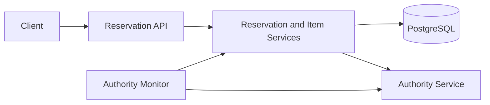

# Launch Day Reservation API

A Java 21 reservation service built for high-concurrency product launches. It
keeps accepting bounded reservations when the upstream authority is unavailable,
then durably reconciles those reservations after the authority recovers.

## Features

- Idempotent reservation creation scoped by user and client-provided key
- Concurrency-safe inventory handling without overselling
- Automatic live and stand-in operating modes
- PostgreSQL-backed durable reconciliation queue
- Ordered recovery of pending reservations after an outage
- Append-only reservation status audit history
- Java 21 virtual-thread HTTP server
- Live concurrency and recovery verification tests

## Tech Stack

- Java 21 and the JDK HTTP server/client
- PostgreSQL 16
- JDBC with HikariCP
- Gson
- Maven and JUnit 5
- Podman and Compose

## Architecture



PostgreSQL is used for both application state and the durable stand-in queue.
Reservations accepted during an authority outage are stored with `pending`
status. Recovery replays them in creation order and changes each status to
`confirmed` or `reversed`.

## Prerequisites

- Java 21
- Maven 3.9 or later
- Podman with Compose support
- Go 1.22 or later (only for `make check`)
- Access to the runtime image configured in `backend/java/Dockerfile`

## Quick Start

Build and start PostgreSQL, the authority service, and the Java API:

```bash
make up
```

The services are available at:

| Service | URL |
| --- | --- |
| Reservation API | `http://127.0.0.1:8080` |
| Authority service | `http://127.0.0.1:9000` |
| PostgreSQL | `127.0.0.1:5432` |

Check service health:

```bash
curl http://127.0.0.1:8080/health
```

Expected response:

```json
{
	"status": "ok",
	"authority": "healthy",
	"mode": "live"
}
```

Stop the stack with:

```bash
make down
```

## API

| Method | Path | Description |
| --- | --- | --- |
| `GET` | `/health` | Report authority health and operating mode |
| `GET` | `/items/{itemId}` | Get live or cached item availability |
| `POST` | `/reservations` | Create an idempotent reservation |
| `GET` | `/reservations/{reservationId}` | Get one reservation |
| `GET` | `/reservations?userId={userId}` | List reservations, optionally by user |
| `GET` | `/admin/audit?reservationId={id}` | Get reservation status history |
| `POST` | `/admin/reconcile` | Reconcile pending reservations |
| `POST` | `/admin/reset` | Clear reservations and refresh inventory |

### Get an Item

```bash
curl http://127.0.0.1:8080/items/hype-001
```

```json
{
	"itemId": "hype-001",
	"name": "Hype Drop 001",
	"available": 50,
	"shadowAvailable": 50,
	"mode": "live"
}
```

### Create a Reservation

The client generates one idempotency key for a booking action and reuses that
same key for retries. A new booking must use a new key.

```bash
curl -i -X POST http://127.0.0.1:8080/reservations \
	-H 'Content-Type: application/json' \
	-H 'Idempotency-Key: 8d601cd5-8e66-4d31-8a89-c9fa9277bf18' \
	-d '{"itemId":"hype-001","userId":"user-001","qty":2}'
```

A confirmed reservation returns `201 Created`:

```json
{
	"reservationId": "<generated-uuid>",
	"itemId": "hype-001",
	"userId": "user-001",
	"qty": 2,
	"status": "confirmed",
	"mode": "live"
}
```

Repeating the same user, key, item, and quantity returns the original
reservation. Reusing the key with a different item or quantity returns `422`.

## Stand-In Mode

Simulate an authority outage:

```bash
make authority MODE=down
curl http://127.0.0.1:8080/health
```

After the monitor detects the outage, valid reservations are stored durably as
`pending` and return `202 Accepted`. Stand-in inventory is protected with a
PostgreSQL row lock and bounded by `STANDIN_MAX_PER_ITEM`.

Restore the authority:

```bash
make authority MODE=healthy
```

After the configured healthy-check threshold, the service replays pending
reservations using their original IDs. Reconciliation can also be requested
manually:

```bash
curl -X POST http://127.0.0.1:8080/admin/reconcile \
	-H 'Content-Type: application/json' \
	-d '{}'
```

## Consistency Model

- A PostgreSQL transaction-level advisory lock serializes requests sharing a
	`(userId, idempotencyKey)` pair.
- A unique partial index provides a final database-level idempotency guarantee.
- `SELECT ... FOR UPDATE` protects shadow inventory and reconciliation rows.
- Reservation changes and audit events commit in the same transaction.
- Pending reservations survive API restarts because the queue is stored in
	PostgreSQL rather than application memory.

## Configuration

| Variable | Default | Purpose |
| --- | --- | --- |
| `PORT` | `8080` | Reservation API port |
| `AUTHORITY_URL` | `http://127.0.0.1:9000` | Authority base URL |
| `DATABASE_URL` | `jdbc:postgresql://localhost:5432/student` | JDBC connection URL |
| `DATABASE_USER` | `launchday` | Database user |
| `DATABASE_PASSWORD` | `launchday` | Local database password |
| `DATABASE_POOL_SIZE` | `24` | Maximum JDBC connection pool size |
| `STANDIN_MAX_PER_ITEM` | `10` | Maximum pending quantity per item |
| `AUTHORITY_BREAKER_POLL_MS` | `1000` | Authority health polling interval |
| `AUTHORITY_BREAKER_HEALTHY_CHECKS` | `3` | Healthy probes required before recovery |

## Project Structure

```text
backend/java/
├── pom.xml
├── schema.sql
└── src/
		├── main/java/launchday/
		│   ├── App.java              # Composition root
		│   ├── api/                  # HTTP routing and responses
		│   ├── client/               # Authority HTTP client
		│   ├── mapper/               # JSON response mapping
		│   ├── model/                # Immutable domain records
		│   ├── repository/           # JDBC persistence and locks
		│   └── service/              # Reservation, inventory, and recovery logic
		└── test/java/launchday/      # Live behavior verification
```

## Verification

Run a clean compilation and unit-test phase:

```bash
mvn -q -f backend/java/pom.xml clean test
```

Run the complete live suite. This starts the Podman stack and tests concurrent
idempotency, inventory races, authority recovery, and final-state replay:

```bash
make verify
```

Run the backend contract checks:

```bash
make check TRACK=backend
```
